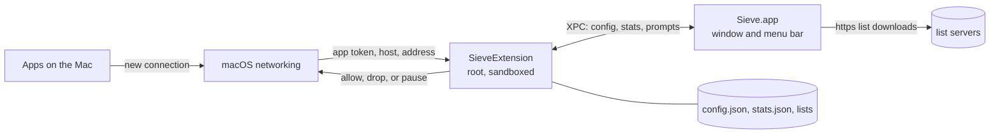
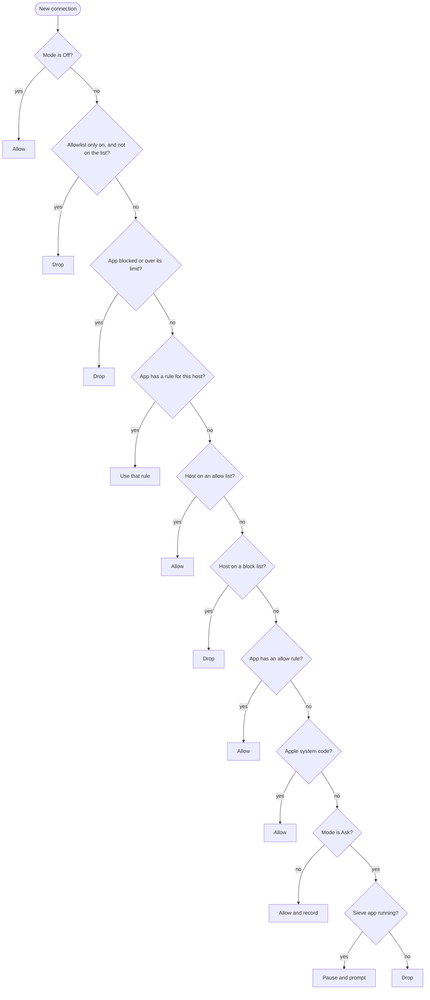

# Sieve

[![macOS 26.0 or later][badge-macos]](#what-you-need)
[![Apple silicon][badge-arch]](#what-you-need)
[![Swift 6][badge-swift]](#project-layout)
[![Licence: GPL-3.0-only][badge-licence]](LICENSE)

Sieve is a firewall for the connections your Mac makes. It shows every
app that goes online and every host it contacts. You allow or block
each app, or single domains of an app. One switch blocks about 78,000
ad, tracker, and malware domains. Everything stays on your Mac.

![The Apps screen of Sieve][img-apps]

Try every screen in your browser at
[sieve-prototype.pilinux.me][prototype], the design prototype with
sample data.

| Part | What you will find |
| --- | --- |
| [1. Get started](#1-get-started) | Features, needs, install, setup |
| [2. Use Sieve](#2-use-sieve) | Each screen, with pictures and recipes |
| [3. Under the hood](#3-under-the-hood) | Design, limits, developer answers, contributing |

## 1. Get started

### What Sieve does

| Feature | What it does |
| --- | --- |
| Per-app rules | Allow or block every outgoing connection of an app. |
| Per-domain rules | Keep an app online, but block single domains. |
| Ask mode | Pause an unknown app's first connection and ask you. |
| Quiet mode | Allow and record unknown apps. Decide later, in one pass. |
| Tracker Shield | Block Steven Black's list of ad and tracker domains. |
| Domain lists | Add your own allow and block lists by URL or file. |
| App X-Ray | Hosts and IP addresses an app contacts, trackers, a grade. |
| Addresses | Every IP address your apps reach, as a table and a map. |
| Address facts | Public DNS, local, and CDN tags, and country and owner. |
| Traffic monitor | The live rate of each app, in the window and menu bar. |
| Rule insights | Hits and last hit per rule, and flags on dead rules. |
| Data limits | Cap an app's data per day or per month. |
| Profiles | Rule sets that switch by network or by time. |
| Diagnostics | Sieve's own errors and warnings, to save and share. |
| Allowlist only | Let out only the hosts and IP addresses on your list. |
| Lock | Every change needs Touch ID or your Mac password. |

Sieve has no account, no server, no analytics, and no third-party code.
It collects no data. See the [privacy policy](PRIVACY.md).

### What you need

- macOS 26.0 or later.
- A Mac with Apple silicon. Builds include Intel, but only Apple
  silicon is tested.
- An administrator password, once, to allow the filter.

### Install

- **Homebrew:**

  ```sh
  brew install --cask pilinux/tap/sieve
  ```

- **Mac App Store:** coming soon.

macOS runs the filter only when Sieve is in `/Applications`. Both ways
put it there.

### Set up

![The setup steps][img-setup]

1. Open Sieve. The window shows **Off** and a **Turn on** button.
2. Click **Turn on**. macOS asks to allow the system extension.
3. Open **System Settings > General > Login Items & Extensions >
   Network Extensions** and switch Sieve on. The window links to that
   page.
4. If macOS asks whether Sieve may filter network content, click
   **Allow**.

The window then shows the Apps screen. A new install starts in **Quiet**
mode with **Tracker Shield** on: nothing breaks, and Sieve starts to
learn what your apps do.

> [!TIP]
> Turn on **Launch at login** at the bottom of the sidebar. In ask mode,
> the app will require your attention for the first connection of an
> unknown app.

### Remove Sieve

1. Drag Sieve from `/Applications` to the Trash.
2. macOS offers to remove the filter. Accept.
3. Sieve's data stays in a folder only an administrator can read. To
   delete it too:

   ```sh
   sudo rm -rf /var/root/Library/Containers/me.pilinux.Sieve.SieveExtension
   ```

## 2. Use Sieve

The pictures come from Sieve's design prototype, with sample apps and
hosts. The app matches them. Try the prototype in your browser at
[sieve-prototype.pilinux.me][prototype].

On every screen, click a host name or an IP address to copy it.

### Pick a mode

The toolbar switches between three modes.

| Mode | An app with no rule | Use it when |
| --- | --- | --- |
| Off | Everything is allowed. | You want to pause the firewall. |
| Ask | Sieve pauses it and asks you. | You want to decide each app. |
| Quiet | Sieve allows and records it. | You decide later, in one pass. |

Rules and lists apply in Ask and Quiet mode alike. Only Off skips them.

> [!IMPORTANT]
> In Ask mode, Sieve blocks apps with no rule while the Sieve app is not
> running. Otherwise any program could quit Sieve to get through.

### Apps

![The Apps screen][img-apps]

- Every app that connected, with its rate, its data, and a privacy
  grade from A to F.
- **Undecided** holds apps with no rule yet. Click ✕ to block or ✓ to
  allow.
- A switch on each app allows or blocks it.
- The overview shows the live rate, 31 days of data, blocked
  connections, and trackers seen.

The grade counts the tracker hosts an app reached that your rules and
lists still let through:

| Grade | A | B | C | D | F |
| --- | --- | --- | --- | --- | --- |
| Open trackers | 0 | 1 to 2 | 3 to 5 | 6 to 10 | 11 or more |

An app that gave no host names shows `–`: its trackers are unknown.

### The Ask prompt

![Four Ask prompts][img-prompt]

In Ask mode, the first connection of an app with no rule waits for you.

- The prompt shows the app's path and its verified signer. A signer that
  Sieve cannot verify shows in red.
- It shows the host, or the IP address when the app gave no host name.

**This host only** sets how wide your answer is:

| This host only | Allow or Block makes | After that |
| --- | --- | --- |
| Off | A rule for the whole app | The app never asks again |
| On | A rule for this host | The app may ask for other hosts |

For example, an app wants `telemetry.example.com`. Block with **This
host only** on drops that host and keeps the app working. Block with it
off cuts the app off.

### App X-Ray

![App X-Ray][img-xray]

Select an app to see every host and IP address it contacted.

- Hosts on a block list carry a tracker mark.
- Each host has its own Allow and Block.
- Each IP address shows the host name seen with it, or "No host name"
  when the app dialled the address or resolved DNS itself. Each has its
  own Allow and Block. A host rule beats an IP rule.
- Set a **data limit** per day or per month. Over the limit, the app's
  new connections fail until the period ends.
- **Clear history** (the round clock button) deletes the app's hosts,
  IP addresses, and byte counts. Its rules and limit stay.
- Each IP address carries a tag when Sieve knows what it is: Public
  DNS, Local DNS, Local network, or a CDN such as Cloudflare. With
  [IPinfo Lite data](#add-country-and-owner-data), the rest show a
  country flag and the network owner.

### Addresses

![The Addresses table][img-addresses]

**Addresses** lists every IP address any app reached, one row each: its
tag, the last host name seen with it, the apps, the flows, and the last
flow.

- Click a column heading to sort. Search matches the address, host,
  owner, or country.
- Click the app icons, or the arrow before the address, to see each
  app's own flows under the row.

![The Addresses map][img-map]

**Map** shades each country by the flows to its addresses. Hover a
country for its addresses, flows, and busiest apps. Click it to see its
addresses in the table. Pinch to zoom and drag to pan, or use the + and
− buttons.

- The map is drawn on your Mac. Sieve loads no map from the internet.
- CDN, DNS, and local addresses have no single place, so they stay off
  the map. **Not on the map** lists their flows.
- The map needs [IPinfo Lite data](#add-country-and-owner-data). Without
  it, no address has a country.

### Add country and owner data

Sieve can show the country and the network owner of each IP address,
such as a German flag, DE, and Hetzner Online GmbH. For that it needs
IPinfo Lite, a free database that you download yourself. Sieve does not
ship it.

![The IP data card on the Lists screen][img-ipdata]

1. Create a free account at [ipinfo.io][ipinfo-lite].
2. Open [your downloads page][ipinfo-downloads] and download IPinfo
   Lite in CSV format, `ipinfo_lite.csv.gz`, about 26 MB.
3. In Sieve, open **Lists**. Under **IP data**, click **Upload** and pick
   the file. Sieve reads it, which can take a minute, then shows the
   number of ranges.
4. Open App X-Ray or **Addresses**. Addresses now show a flag, a country
   code, and the owner. Hover one for the country name, AS number, and
   domain.

To update, download a new copy and upload it again. IPinfo updates the
file daily, so once a month is plenty. The trash button removes Sieve's
copy.

Your privacy stays intact:

- **Sieve never contacts IPinfo.** It sends no address and no token.
  Every lookup happens on your Mac.
- **The download is the only contact.** IPinfo sees your account fetch
  the same file every user gets. It never learns which addresses your
  apps reach.
- **Sieve keeps no token.** It keeps a compact copy of the data in its
  own folder, and the filter never reads it. You can delete the
  downloaded file after the upload.

What the tags mean:

| Tag | Meaning |
| --- | --- |
| Public DNS | A public resolver on Sieve's list, such as Cloudflare |
| Local DNS | A DNS server on your network, such as your router |
| DNS | Another DNS server that an app sent lookups to |
| Local network | An address on a local network |
| CDN · Fastly | A CDN address, from the provider's own published list |
| Flag, code, owner | The country and network owner, from IPinfo Lite |

- The country is where IPinfo places the address. A cloud or anycast
  address can serve from anywhere.
- A CDN address shows the CDN, not a country, since it answers from many
  places.
- IPinfo Lite names the owner but not its type, so Sieve does not guess
  whether it is an ISP or a data center.

### Lists

![The Lists screen][img-lists]

**Tracker Shield** is one switch. It holds [Steven Black's unified
hosts][hosts]. Its first copy ships inside Sieve, so it works offline
from the start. Refresh downloads the latest copy.

Under it, four **extensions** add Steven Black's Fake news, Gambling,
Adult content, and Social lists. None ships with Sieve. Each downloads
when you first turn it on. Off keeps the copy, Refresh downloads a new
one, and Delete removes it.

To add your own list, paste an `https` URL and click **Add**, or click
**Upload** and pick a file. Choose Block or Allow first. Allow lists win
over block lists.

**Check a domain** shows which lists have a host and whether they block
it. Type a host name or a URL and press Return. Click ✕ to clear the
result.

A list is plain UTF-8 text in one of two forms:

```text
# One host per line
ads.example.com
tracker.example.net
```

```text
# Hosts-file lines: the first word, an IP address, is skipped
0.0.0.0 ads.example.com
127.0.0.1 metrics.example.org stats.example.org
```

- Text after `#` is a comment. Words without a dot, and IP addresses,
  are skipped.
- An entry covers its host and every subdomain. `example.com` covers
  `www.example.com`, but not `notexample.com`. No wildcards are needed.
- JSON, CSV, and Adblock syntax such as `||example.com^` do not work.
- A list may hold up to 16 MB.

> [!TIP]
> [Peter Lowe's list][yoyo] works when served as plain text. Use the
> link below.
>
> ```text
> https://pgl.yoyo.org/adservers/serverlist.php?hostformat=hosts&showintro=0&mimetype=plaintext
> ```

### Allowlist only

**Allowlist only** on the Lists screen blocks every connection whose
host or IP address is not on a file you upload. Apple apps are blocked
too. Only the macOS services that keep the Mac working stay allowed:
DNS (`mDNSResponder`), time (`timed`), certificate checks (`trustd`),
DHCP (`configd`), and the captive portal check (`captiveagent`).

The file is a `.csv` or `.txt` with one entry per line:

```text
# A host covers its subdomains
example.com
# An IP address, or a range as prefix/length
203.0.113.24
10.0.0.0/8
2001:db8::/32
```

- Only the first comma field counts, so a CSV with more columns works.
- Sieve removes duplicates, and entries a listed parent domain or range
  already covers. The card shows how many lines it kept, dropped, and
  skipped, and **Save a copy** writes the clean list.
- A new upload replaces the list. **Delete** turns Allowlist only off
  and removes the list.
- A connection on the list still goes through your rules, block lists,
  and Ask mode.
- An app that looks up names itself shows Sieve only an IP address. List
  its addresses too.
- List downloads need their host on the list, such as
  `raw.githubusercontent.com` for Tracker Shield.

### Lock

Turn on **Lock settings** at the bottom of the sidebar. While Sieve is
locked, controls that change something are dimmed. A click on one asks
for Touch ID or your Mac password, then makes the change. Every **Save
a copy** asks for it too. Reading, search, and Check a domain need no
unlock.

- The Ask prompt still shows. Your answer asks for the unlock first.
- The toolbar and the menu bar window show **Locked** or **Unlocked**.
  Click it to unlock or lock.
- Sieve locks again when the screen locks, when the Mac sleeps, and 5
  minutes after the unlock or the last change.

The lock stops a person who does not know your Mac password. Anyone who
knows it can unlock Sieve, and an administrator can turn the filter off
in System Settings.

### Rules

![The Rules screen][img-rules]

Rules is a grid. Each row is an app, or an app and one host. The columns
are **Always**, then one per profile. Each cell has ✓ Allow and ✕ Block.

- Click ✓ or ✕ to set a cell. Click it again to clear it.
- A profile cell beats **Always** while that profile is active. An empty
  profile cell follows **Always**.
- Each row shows its hits and its last hit.
- The trash button deletes the row's rules. The app's history stays.

Sieve flags rules that can never fire:

| Flag | Meaning |
| --- | --- |
| App is gone | The app is no longer on the Mac. |
| App is blocked | A host rule under a block on the whole app. |
| On a block list | A list blocks this host already. |
| Parent domain rule | A rule for a parent domain does the same. |

### Profiles

![The Profiles screen][img-profiles]

A profile is a set of rules for a place or a time. It is active on its
network, or during any of its time blocks.

- **Use this network** saves the network the Mac is on now. Sieve knows
  it by its router's IP and MAC address. No Location permission is
  needed.
- **Add time** adds a block of weekdays with a start and an end. A block
  ends by 24:00. For a night, use two blocks.
- One profile is active at a time: the first in the list that matches.
  Order matters.

### Menu bar

![The menu bar window][img-menu]

Click the Sieve icon in the menu bar for the live rate, the five busiest
apps with a switch each, and blocked connections for the last seven
days.

### Diagnostics

![The Diagnostics screen][img-diagnostics]

Sieve logs its own errors and warnings, such as a file it cannot write
or a list it cannot download. The page shows how many there are since
a date, and the newest 50.

- **Save a copy** writes both logs, the app's and the filter's, to one
  file: JSON Lines, one entry per line. Attach it to a bug report.
- **Reset** deletes every entry.

The log holds no personal data: no hosts, IP addresses, URLs, list or
profile names, or your user name. Each file keeps its newest 2,000
entries.

### Recipes

**Block one domain for one app.** Open the app in App X-Ray, find the
host, and click Block. The app stays online. The rule covers the
host's subdomains.

**Keep a backup app off your phone's hotspot.** In Profiles, create
"Hotspot" and click **Use this network** while on the hotspot. In
Rules, click ✕ in the Hotspot column of the backup app. Its ✓ in
**Always** keeps it online everywhere else.

**Allow an app only at work hours.** Create a profile "Work" with a time
block, Monday to Friday, 09:00 to 17:00. Block the app in **Always** and
allow it in the Work column.

**Sort out a new Mac.** Stay in Quiet mode for a few days. Then open
Apps, go through **Undecided**, and block or allow each app. Switch to
Ask mode once the list is empty.

### Family and malware DNS

Sieve reads the names in plain DNS lookups. It cannot read encrypted
ones: DNS over HTTPS, DNS over TLS, or secure DNS in a browser. For an
app that sends encrypted lookups, Sieve sees only IP addresses. Tracker
Shield, your lists, and host rules cannot match it. App rules still
apply.

So let the DNS service block too. An encrypted DNS service with filters
blocks ads, trackers, and malware for every app. It also hides your
lookups from your ISP and from the network you are on.

[DeCloudUs][decloudus] does both: it blocks ads, trackers, and malware,
and offers only encrypted DNS. Its public resolver needs no account:

```text
DNS over HTTPS   https://dns.decloudus.com/dns-query
DNS over TLS     dns.decloudus.com
```

Other services that filter:

| Service | Blocks |
| --- | --- |
| [DNS4EU][dns4eu] Child, no ads | Ads, trackers, malware, adult |
| [LibreDNS][libredns] No ads | Ads, trackers |
| [Cloudflare][cf-families] Security | Malware |
| [Cloudflare][cf-families] Family | Malware, adult |
| [AdGuard DNS][adguard-dns] Family | Trackers, malware, adult |

Their DNS addresses and encrypted URLs:

```text
DNS4EU Child, no ads   86.54.11.11  86.54.11.211
  https://child-noads.joindns4.eu/dns-query
LibreDNS No ads        encrypted only
  https://doh.libredns.gr/noads
Cloudflare Security    1.1.1.2  1.0.0.2
  https://security.cloudflare-dns.com/dns-query
Cloudflare Family      1.1.1.3  1.0.0.3
  https://family.cloudflare-dns.com/dns-query
AdGuard DNS Family     94.140.14.15  94.140.15.16
  https://family.adguard-dns.com/dns-query
```

For more, see AdGuard's [list of known DNS providers][dns-providers].

> [!IMPORTANT]
> Secure DNS in the browser hides names from Sieve, so only the DNS
> service blocks for that browser. Pick one that blocks ads, trackers,
> and malware, such as DeCloudUs. You can also set encrypted DNS on the
> Mac and turn secure DNS off in the browser. Then the browser asks macOS
> for names, Sieve can see them, and the DNS service can filter them.

## 3. Under the hood

### How it fits together



- The filter is an `NEFilterDataProvider`, packaged as a system
  extension. It sees each new outgoing flow, never its contents.
- The extension owns all state. The app is a client over one XPC Mach
  service, and the extension accepts only the Sieve app signed by the
  same team.
- The app downloads lists. The extension has no network access of its
  own.
- Swift 6 and SwiftUI. No third-party packages.

### How Sieve decides

The extension decides each new connection from memory, in this order.
The first match wins.



- A rule of the active profile beats an **Always** rule for the same
  app and host.
- A host rule covers the host and its subdomains. The most specific
  rule wins, so a block on `example.com` and an allow on
  `cdn.example.com` allow the CDN and block the rest.
- The extension fails open: if it cannot decide, it allows. The one
  exception is Ask mode with no Sieve app running.
- A list check walks the host and each parent domain. On the 78,217
  entries of Tracker Shield it takes about 1.2 µs per list, about 0.1 %
  of one core at 200 new connections a second.

### How Sieve names an app

Each connection carries an audit token for its process. Sieve reads the
code signature of that process and gives the app a key:

| Code | Key | Example |
| --- | --- | --- |
| Signed by a developer | `TEAMID.identifier` | `ABCDE12345.com.example.app` |
| Signed by Apple | The identifier | `com.apple.Safari` |
| Anything else | The path | `/opt/homebrew/bin/wget` |

- A Team ID counts only when the signing certificate carries it. A
  copied or altered app gets its own key, not the original's rules.
- Code inside an app bundle counts as the outermost app, when the same
  signer signed both.
- A path key also holds the hash of the running code. An Allow rule for
  it counts only for that code, so a changed binary asks again.
- The filter's sandbox cannot read every program, for example in
  `/opt/homebrew` or `~/Applications`. Such a program gets a path key
  with no verified signer. Its Allow rules count only while the file
  keeps its inode and status-change time.
- A program in a folder that System Integrity Protection guards, such
  as `/usr/libexec`, counts as Apple code.
- Apple's daemons are allowed with no rule. Apple's command-line tools,
  such as `curl`, `ssh`, and `osascript`, are not: any app can run them,
  so they prompt and take rules like any app.

### Where data lives

The filter runs as `root` in its own sandbox. Its files sit in its
container:

```text
/var/root/Library/Containers/me.pilinux.Sieve.SieveExtension/Data/
└── Library/Application Support/me.pilinux.Sieve/
    ├── config.json     mode, rules, lists, limits, profiles
    ├── stats.json      hosts, bytes, blocked counts, rule hits
    └── lists/<id>.txt  a copy of each list
```

The app keeps the IPinfo Lite copy, `ipinfo.bin`, in its own
container. Only the app reads it:

```text
~/Library/Containers/me.pilinux.Sieve/Data/
└── Library/Application Support/me.pilinux.Sieve/ipinfo.bin
```

Read the filter's files with `sudo`:

```sh
dir="/var/root/Library/Containers/me.pilinux.Sieve.SieveExtension/Data"
sudo ls -l "$dir/Library/Application Support/me.pilinux.Sieve"
```

How long Sieve keeps its stats:

| Data | Kept |
| --- | --- |
| Hosts of an app | 31 days since last seen, at most 1,000 |
| Daily bytes and blocked counts | 31 days |
| An app with no rule and no limit | 31 days since last seen |
| Hits of a rule | Until the rule is deleted |

If `config.json` cannot be read, Sieve moves it aside as
`config.json.broken`, starts with defaults, and shows a notice. **Save a
copy** keeps the file for you. **Discard** deletes it.

### Limits

- **No host name, no domain match.** Apps that look up names
  themselves give only an IP address. Sieve reads their plain DNS
  lookups on port 53 and drops a lookup of a blocked name. Encrypted
  DNS, such as Chrome with secure DNS, hides the name, so domain rules
  and lists cannot match. App rules still apply.
- **Web pages show as WebKit.** Safari and every app with a web view
  load pages through `com.apple.WebKit.Networking`. No public API names
  the app behind it, so one rule for it covers all of them. A rule for
  Safari does not cover its pages.
- **DNS leaves through the system.** Name lookups go through
  `mDNSResponder`, not the app. A blocked app can still look up names.
- **New connections only.** A new rule, list, profile, or limit acts on
  new connections. Open ones run until they close.
- **Shared tools.** A rule for `curl` covers every app that runs `curl`.
  An allowed interpreter, such as `python3`, runs any script with its
  rules.
- **Networks can be copied.** A network is known by its router's IP and
  MAC address. A hostile network that copies both gets the profile of a
  trusted one. Networks with IPv6 only cannot be a profile's network.
- **Changing code asks again.** An update of a tool with no verified
  signer, such as a Homebrew binary, changes its code. Ask mode prompts
  for it once more. Unsigned code prompts on every connection. For a
  program the filter cannot read, `chmod` or a move also asks again.
- **Some Apple tools pass.** Apple code outside `/bin/`, `/usr/bin/`,
  and `/Library/Developer/` counts as a daemon, allowed with no rule.
  A few tools live there too, such as `/usr/sbin/ab` and `tclsh`, so
  any app can connect through them without a prompt.
- **Outgoing only.** The macOS firewall covers incoming connections.
- **Not yet tested:** iCloud Private Relay may hide Safari traffic from
  the filter.

### Questions developers ask

#### Why a content filter, not a VPN or packet tunnel?

`NEFilterDataProvider` decides per flow and hands the filter the app's
audit token. It routes no traffic and reads no contents except plain
DNS lookups, so it runs next to a VPN. A packet tunnel would see
packets without the app behind them.

#### Why does Ask mode drop connections when the app is closed?

The prompt lives in the app. If the extension allowed unknown apps
while the app was gone, any program could quit Sieve and get through.
Quiet mode never drops for this reason.

#### Why can a blocked app still look up names?

macOS resolves names in `mDNSResponder`, a system daemon. The filter
sees that daemon's connections, not the app's. Blocking it would break
every app.

#### Why do open connections survive a new rule?

The filter decides when a flow starts. Cutting a flow later would mean
reading the data of every allowed connection, which Sieve never does.

#### How does Sieve know a network without Location permission?

The extension watches `SCDynamicStore`. macOS gives each IPv4 network a
`NetworkSignature` with the router's IP and MAC address. Sieve stores
the whole string, so two homes that both use `192.168.1.1` stay apart.

#### Where does Tracker Shield load from?

The first copy ships in the extension bundle as `trackers.txt`. After
the first Refresh, the extension loads `lists/tracker-shield.txt` from
its data folder instead. Each extension downloads its
`alternates/<name>-only/hosts` file and keeps it as
`lists/tracker-shield-<name>.txt`.

#### How do I build Sieve myself?

You need Xcode 27 and a paid Apple Developer Program membership. The
Network Extension and System Extension capabilities require it.

1. Clone the repo and open `Sieve.xcodeproj`.
2. In both targets, set your team under **Signing & Capabilities**.
3. Change the bundle IDs `me.pilinux.Sieve` and
   `me.pilinux.Sieve.SieveExtension`, and the app group, to your own.
   The code names them in `Sieve/Filter.swift`,
   `SieveExtension/FilterDataProvider.swift`, and
   `SieveExtension/Info.plist`.
4. Build, copy to `/Applications`, and open:

   ```sh
   xcodebuild -scheme Sieve -destination 'platform=macOS,arch=arm64' \
     -derivedDataPath build -quiet \
     CURRENT_PROJECT_VERSION="$(date +%s)" build
   ditto build/Build/Products/Debug/Sieve.app /Applications/Sieve.app
   open /Applications/Sieve.app
   ```

System Integrity Protection stays on. macOS loads the extension only
from `/Applications`, and replaces it only when the build number
changes, hence the fresh `CURRENT_PROJECT_VERSION`. Check the state
with:

```sh
systemextensionsctl list
/usr/bin/log show --last 5m --predicate 'subsystem BEGINSWITH "me.pilinux"'
```

App and host names show as `<private>` in the log, by design.

#### How do I run the tests?

```sh
xcodebuild -scheme Sieve -destination 'platform=macOS,arch=arm64' \
  -derivedDataPath build -quiet test
swift format lint -r Sieve Shared SieveExtension SieveTests
```

Tests cover the pure logic in `Shared/`: the verdict order, list
parsing and matching, rule flags, grades, data limits, profiles, stats
limits, and decoding of saved files.

### Project layout

| Folder | Holds |
| --- | --- |
| `Sieve/` | The app: window, menu bar, prompts, list downloads |
| `SieveExtension/` | The filter: verdicts, app identity, storage |
| `Shared/` | Models, verdict logic, list parser, XPC protocol |
| `SieveTests/` | Swift Testing tests for `Shared/` |
| `design/` | The browser prototype of every screen |

### Contributing

Thanks for your interest in contributing. Bug reports, ideas,
documentation, and code are all welcome. Start with
[CONTRIBUTING.md](CONTRIBUTING.md). Before your first pull request is
merged, you sign the [Contributor License Agreement](CLA.md).

### Credits and licence

- [Steven Black's unified hosts][hosts], MIT License, is the Tracker
  Shield list. Its licence ships next to it in the extension.
- Aileron, by Sora Sagano, CC0 1.0, is the app's font.
- The map uses [Natural Earth][natural-earth] country shapes, public
  domain.
- The CDN list comes from each provider's own published IP list. The
  public DNS list comes from each resolver's own pages.
- [IPinfo Lite][ipinfo-lite], CC BY-SA 4.0, supplies country and owner
  data when you upload it. Sieve does not ship it.
- [LuLu][lulu] and [Pi-hole][pihole] shaped the feature set.

Sieve: a per-app firewall for macOS with Ask and Quiet modes and tracker
blocking.
Copyright (C) 2026 Mahir Hasan

This program is free software: you can redistribute it and/or modify it
under the terms of the GNU General Public License as published by the
Free Software Foundation, version 3.

This program is distributed in the hope that it will be useful, but
WITHOUT ANY WARRANTY; without even the implied warranty of
MERCHANTABILITY or FITNESS FOR A PARTICULAR PURPOSE. See the GNU General
Public License for more details.

You should have received a copy of the GNU General Public License along
with this program. If not, see <https://www.gnu.org/licenses/>.

[hosts]: https://github.com/StevenBlack/hosts
[prototype]: https://sieve-prototype.pilinux.me
[ipinfo-lite]: https://ipinfo.io/lite
[ipinfo-downloads]: https://ipinfo.io/dashboard/downloads
[natural-earth]: https://www.naturalearthdata.com
[yoyo]: https://pgl.yoyo.org/adservers/
[lulu]: https://objective-see.org/products/lulu.html
[pihole]: https://pi-hole.net
[decloudus]: https://decloudus.com/public-dns
[dns-providers]: https://adguard-dns.io/kb/general/dns-providers/
[cf-families]: https://developers.cloudflare.com/1.1.1.1/setup/
[dns4eu]: https://www.joindns4.eu/for-public
[libredns]: https://libredns.gr
[adguard-dns]: https://adguard-dns.io/en/public-dns.html
[badge-macos]: https://img.shields.io/badge/macOS-26.0%2B-black
[badge-arch]: https://img.shields.io/badge/Apple%20silicon-tested-brightgreen
[badge-swift]: https://img.shields.io/badge/Swift-6-orange
[badge-licence]: https://img.shields.io/badge/licence-GPL--3.0--only-blue
[img-apps]: https://sieve-prototype.pilinux.me/images/apps.jpg
[img-setup]: https://sieve-prototype.pilinux.me/images/setup.jpg
[img-prompt]: https://sieve-prototype.pilinux.me/images/prompt.jpg
[img-xray]: https://sieve-prototype.pilinux.me/images/xray.jpg
[img-addresses]: https://sieve-prototype.pilinux.me/images/addresses.jpg
[img-map]: https://sieve-prototype.pilinux.me/images/map.jpg
[img-ipdata]: https://sieve-prototype.pilinux.me/images/ipdata.jpg
[img-lists]: https://sieve-prototype.pilinux.me/images/lists.jpg
[img-rules]: https://sieve-prototype.pilinux.me/images/rules.jpg
[img-profiles]: https://sieve-prototype.pilinux.me/images/profiles.jpg
[img-menu]: https://sieve-prototype.pilinux.me/images/menu.jpg
[img-diagnostics]: https://sieve-prototype.pilinux.me/images/diagnostics.jpg
